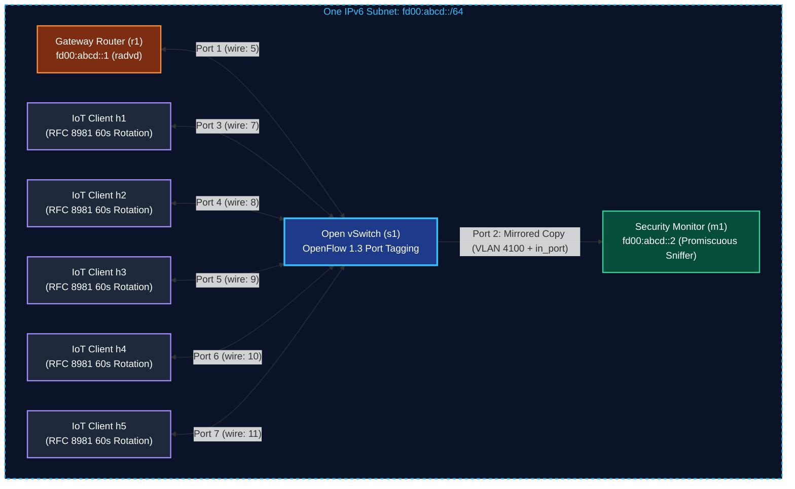

# A3-PS007-TC042
Privacy-Aware IPv6 IoT Security Monitoring Across Address Rotation  
Maps traffic based on port via OpenvSwitch to session ids

## Team Members
Nishant Majumdar  
Sayan Ghosh  
Dr Avijit Mondal

# YouTube Video link

https://www.youtube.com/watch?v=EdSLA-Ccn4k

---

## 1. Project Overview & Architectural Highlights

Modern Internet of Things (IoT) devices in IPv6 subnets utilize **RFC 8981 (Privacy Extensions for SLAAC)** to prevent tracking by third-party observers. Endpoints periodically randomize their interface identifiers (IIDs) and rotate their global unicast IPv6 addresses (e.g. every 60 seconds).

In traditional Network Intrusion Detection Systems (NIDS), operators track rotating addresses by binding them back to Layer 2 Ethernet MAC addresses (`Ether.src`). However, in zero-trust, privacy-preserving, or multi-tenant subnets, **hardware MAC fingerprinting is strictly forbidden** due to surveillance risks, device profiling, and regulatory mandates. Furthermore, malicious nodes exploit RFC 8981 address rotation by generating **rotating-source Neighbor Discovery Protocol (NDP) floods**, blinding conventional per-IP rate limiters.

### The PS-007 Solution:
1. **Zero Hardware MAC Fingerprinting:** All Layer 2 Ethernet source addresses are stripped and dropped immediately upon ingress. No MAC address is ever recorded in RAM, persisted to disk, or broadcast in telemetry.
2. **Deterministic Link-Anchor Attribution:** OpenFlow 1.3 pushes an 802.1Q VLAN tag (`4100 + in_port`) on mirrored packets. The monitor derives a local session anchor (`SES-PORTxx`) directly from physical switch topology.
3. **Epoch-Keyed Ephemeral Pseudonyms:** Anchors map to short-lived, un-linkable 8-character pseudonyms:
   $$P = \text{HMAC-SHA256}(K_{\text{epoch}}, \; \text{tenant} \parallel \text{session})[0:8]$$
   *(Implemented as `P = HMAC(K_epoch, tenant || session_id)[:8]`)*
   When epochs rotate (every 300s), old keys are actively overwritten with zeroes in RAM for forward secrecy.
4. **Passive RFC 4862 DAD Tracking (Primary Mode A):** IoT clients remain 100% black boxes running standard Linux kernel networking. Rotations are captured passively via Duplicate Address Detection Neighbor Solicitations with strict rate bounding.
5. **Multi-Layer Protocol Anomaly Detection:** Replaces flawed Median Absolute Deviation (MAD) heuristics with RFC 4861 token buckets, $n$-of-$m$ hysteresis, CUSUM drift detection, target cardinality scanning, and RFC 6105 RA-Guard.
6. **Integrated Web SOC Dashboard:** Clean monitoring web dashboard running on Flask, packaged directly into `monitor.py` on `http://localhost:5000` with dedicated pages for client tracking, 2D topology mapping, attack logs, live stream console, and IP rotation chains.

For complete architectural specifications, module descriptions, and formal security guarantees, see [`src/README.md`](src/README.md).

---

## 2. Physical Network Topology



---

## 3. Quick Start Guide (One-Click Docker)

[](https://hub.docker.com/r/nishantmajumdar/ps007-ipv6-monitor)

The complete SDN emulation, Open vSwitch daemon, zero-MAC sniffer engine, and Web SOC Dashboard are published on Docker Hub:  
👉 **Docker Repository:** [hub.docker.com/r/nishantmajumdar/ps007-ipv6-monitor](https://hub.docker.com/r/nishantmajumdar/ps007-ipv6-monitor)

### Host Prerequisite (Required for XTerm GUI Windows)
The host system must have the `xhost` utility installed so Docker can display GUI XTerm windows on your desktop. If `xhost` is not installed, the first command will fail and XTerm windows inside Mininet will not open:

- **Ubuntu / Debian:**
  ```bash
  sudo apt update
  sudo apt install -y x11-xserver-utils
  ```
- **Arch Linux / CachyOS:**
  ```bash
  sudo pacman -S --needed xorg-xhost
  ```

---

### Run the Container
Execute the following commands on your host terminal:

```bash
# 1. Allow container to display GUI xterm windows on host
xhost +local:root

# 2. Run container (Docker will automatically fetch the ~84 MB image from Docker Hub)
docker run -it --privileged \
  -e DISPLAY=$DISPLAY \
  -v /tmp/.X11-unix:/tmp/.X11-unix:rw \
  -v /lib/modules:/lib/modules:ro \
  -p 5000:5000 -p 8765:8765 \
  nishantmajumdar/ps007-ipv6-monitor:latest
```

**Single-line copy-paste command:**
```bash
xhost +local:root && docker run -it --privileged -e DISPLAY=$DISPLAY -v /tmp/.X11-unix:/tmp/.X11-unix:rw -v /lib/modules:/lib/modules:ro -p 5000:5000 -p 8765:8765 nishantmajumdar/ps007-ipv6-monitor:latest
```

*(Or if you have cloned this repository: `xhost +local:root && docker compose run --rm --service-ports ps007-monitor`)*

---

### 3.1 Evaluator Step-by-Step Guide (`mininet>` Prompt)

Once the container boots, you are at the Mininet CLI prompt (`mininet>`). Follow these simple steps:

#### Step 1: Start the Security Monitor on `m1` (Launches Web UI)
From within Mininet, open a terminal window for monitor node `m1`:
```bash
mininet> xterm m1
```
Then, inside the newly opened `m1` terminal, launch the monitor:
```bash
python3 monitor.py
```
*(Or if running headless without X11: `mininet> m1 python3 monitor.py &`)*

**Once `monitor.py` starts, open your web browser to:**
```
http://localhost:5000
```
*(Or click the clickable link printed in the `m1` terminal banner).*

---

#### Step 2: Generate Benign Traffic & Observe RFC 8981 Rotations
From within Mininet, launch shells for clients:
```bash
mininet> xterm h1 h2 h3
```
Then, inside client `h1`, ping the Gateway router:
```bash
ping -6 -c 5 fd00:abcd::1
```
*(Or directly from Mininet CLI: `mininet> h1 ping -6 -c 5 fd00:abcd::1`)*

*What happens:*
* Client `h1` emits RFC 4862 DAD Neighbor Solicitations.
* The Attribution Engine binds addresses to physical switch ports (`SES-PORT03`) and maps them to pseudonyms.
* Clients appear on the dashboard client table and 2D network map.
* **Every 60 seconds**, the Linux kernel rotates to a new temporary IPv6 address. The dashboard seamlessly records the new address in `5- ip rotation history` while preserving the authenticated session. You can inspect the client's addresses at any time:
  ```bash
  mininet> h1 ip -6 addr show dev h1-eth0
  ```

---

#### Step 3: Simulate Security Attacks & Observe Detection

##### Attack Scenario A: Rogue Router Advertisement Injection
From within Mininet, open a terminal for `h4` (or run directly from CLI):
```bash
mininet> xterm h4
# Then inside h4 terminal: python3 attacks/rogue_ra.py
```
*(Or directly from Mininet CLI: `mininet> h4 python3 attacks/rogue_ra.py`)*

* **Detection:** Captured by `RogueRADetector` (RFC 6105 RA-Guard). Port 4 is immediately flagged as `ROGUE ATTACKER` and turns **solid crimson red** on the Web SOC Map and Client Table.

##### Attack Scenario B: Rotating-Source NDP Flood & Network Sweep
From within Mininet, open a terminal for `h3` (or run directly from CLI):
```bash
mininet> xterm h3
# Then inside h3 terminal: python3 attacks/ndp_flood.py
```
*(Or directly from Mininet CLI: `mininet> h3 python3 attacks/ndp_flood.py`)*

* **Detection:** The attacker randomizes their source IPv6 address every 2 seconds to evade per-IP rate limiters. Because all packets arrive from physical Port 3, the monitor maps every rotating IP to the **same pseudonym $P$**, exhausting token buckets and triggering `NDP_RATE_ABUSE_HYSTERESIS` and `NDP_SCAN_CARDINALITY_ALERT`.
*(Or with scanning mode: `mininet> h3 python3 attacks/ndp_flood.py -t NS -r 15.0 --rotate-sec 2.0 --scan`)*

---

## 4. More Information

For exhaustive technical documentation, consult [`src/README.md`](src/README.md):
- 7-Layer Deep Technology Stack
- Ingress Zero-MAC & Security Attribution Pipeline Diagram
- Forward Secrecy & Key Ratchet Proofs
- REST API Reference (`/api/state`, `/api/history`, `/api/stream`, `/api/privacy_audit`)
- Optional Mode B (Active Cryptographic Hash Ratchet over UDP port 9000)
