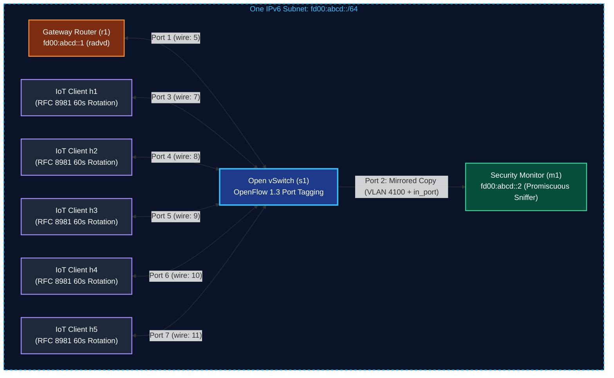
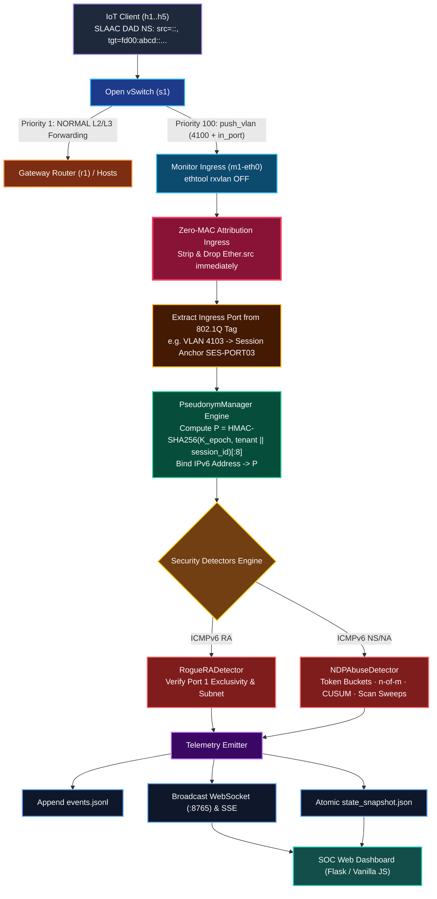
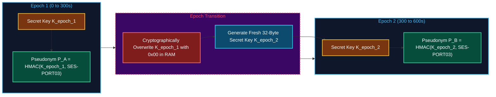

# PS-007: IPv6 IoT Security Monitoring System
### Privacy-Aware Ephemeral Attribution, RFC 8981 Rotation Tracking, and Anomaly Detection

> **The Network Project** A3-PS007-TC042 
> **Strict Operational Constraint:** Zero Hardware MAC Fingerprinting (`Ether.src` stripped at ingress).  
> **Primary Philosophy:** Passive Black-Box IoT Tracking (Mode A) with Zero Client Software Dependencies.

---

## Table of Contents
1. [Executive Summary & Problem Statement](#1-executive-summary--problem-statement)
2. [Full Setup Guide to Running on Your System](#2-full-setup-guide-to-running-on-your-system)
3. [Compliance Verification: The 8 Core Requirements](#3-compliance-verification-the-8-core-requirements)
4. [Full Technology Stack (7 Layers)](#4-full-technology-stack-7-layers)
5. [System Architecture & Ingress Pipeline](#5-system-architecture--ingress-pipeline)
6. [Core Engine Modules in Detail](#6-core-engine-modules-in-detail)
   - [6.1 `ps007_topology.py` - Mininet & OpenFlow 1.3 Tagging](#61-ps007_topologypy---mininet--openflow-13-tagging)
   - [6.2 `attribution.py` - Zero-MAC Attribution & DAD Binding](#62-attributionpy---zero-mac-attribution--dad-binding)
   - [6.3 `pseudonym.py` - Epoch-Keyed Pseudonyms & Forward Secrecy](#63-pseudonympy---epoch-keyed-pseudonyms--forward-secrecy)
   - [6.4 `detectors.py` - RA-Guard & Multi-Layer NDP Abuse Engine](#64-detectorspy---ra-guard--multi-layer-ndp-abuse-engine)
   - [6.5 `optional_mode_b/ratchet.py` - Active Cryptographic Ratchet](#65-optional_mode_bratchetpy---active-cryptographic-ratchet)
   - [6.6 `telemetry.py` - Native RFC 6455 WebSocket & Streaming](#66-telemetrypy---native-rfc-6455-websocket--streaming)
   - [6.7 `frontend/` - 2016-Era Enterprise Web SOC Dashboard](#67-frontend---2016-era-enterprise-web-soc-dashboard)
7. [Adversary Models & Attack Scenarios](#7-adversary-models--attack-scenarios)
8. [REST API & Telemetry Event Schema](#8-rest-api--telemetry-event-schema)
9. [Zero-MAC Compliance Verification Command](#9-zero-mac-compliance-verification-command)

---

## 1. Executive Summary & Problem Statement

Internet of Things (IoT) endpoints deployed in modern IPv6 subnets utilize **RFC 8981 (Privacy Extensions for SLAAC)** to prevent tracking by third-party observers. Endpoints periodically randomize their interface identifiers (IIDs) and rotate their global unicast IPv6 addresses (e.g., every 60 seconds).

In conventional Network Intrusion Detection Systems (NIDS), operators track rotating addresses by binding them back to Layer 2 Ethernet MAC addresses (`Ether.src`). However, in zero-trust, privacy-preserving, or multi-tenant subnets, **hardware MAC fingerprinting is strictly forbidden** due to surveillance risks, device profiling, and regulatory requirements.

Furthermore, attackers exploit RFC 8981 address rotation by generating **rotating-source Neighbor Discovery Protocol (NDP) floods**, which completely blind legacy per-IP rate limiters.

### The PS-007 Solution:
1. **Zero Hardware MAC Fingerprinting:** All Layer 2 Ethernet source addresses are stripped and dropped immediately upon ingress. No MAC address is ever recorded in RAM, persisted to disk, or broadcast in telemetry.
2. **Deterministic Link-Anchor Attribution:** OpenFlow 1.3 pushes an 802.1Q VLAN tag (`4100 + in_port`) on mirrored packets. The monitor derives a local session anchor (`SES-PORTxx`) directly from physical switch topology.
3. **Epoch-Keyed Ephemeral Pseudonyms:** Anchors map to short-lived, un-linkable 8-character pseudonyms:
   $$P = \text{HMAC-SHA256}(K_{\text{epoch}}, \; \text{tenant} \parallel \text{session})[0:8]$$
   *(Implemented as `P = HMAC(K_epoch, tenant || session_id)[:8]`)*
4. **Passive RFC 4862 DAD Tracking (Primary Mode A):** IoT clients remain 100% black boxes running standard Linux kernel networking. Rotations are captured passively via Duplicate Address Detection Neighbor Solicitations with strict rate bounding.
5. **Multi-Layer Protocol Anomaly Detection:** Replaces flawed Median Absolute Deviation (MAD) heuristics with RFC 4861 token buckets, $n$-of-$m$ hysteresis, CUSUM drift detection, target cardinality scanning, and RFC 6105 RA-Guard.
6. **Web Dashboard:** Clean, high-performance monitoring web dashboard running on Flask with dedicated pages for client tracking, 2D topology mapping, attack logs, live stream console, and IP rotation chains.

---

## 2. Quick Start Guide (One-Click Docker)

[](https://hub.docker.com/r/nishantmajumdar/ps007-ipv6-monitor)

The complete SDN emulation, Open vSwitch daemon, zero-MAC sniffer engine, and Web SOC Dashboard are published on Docker Hub:  
👉 **Docker Repository:** [hub.docker.com/r/nishantmajumdar/ps007-ipv6-monitor](https://hub.docker.com/r/nishantmajumdar/ps007-ipv6-monitor)

### Host Prerequisite (Required for XTerm GUI Windows)
The host system must have the `xhost` utility installed so Docker can display GUI XTerm windows on your desktop. If `xhost` is not installed, the first command will fail and XTerm windows inside Mininet will not open:

- **Ubuntu / Debian:**
  ```bash
  sudo apt update
  sudo apt install -y x11-xserver-utils
  ```
- **Arch Linux / CachyOS:**
  ```bash
  sudo pacman -S --needed xorg-xhost
  ```

---

### Run the Container
Execute the following commands on your host terminal:

```bash
# 1. Allow container to display GUI xterm windows on host
xhost +local:root

# 2. Run container (Docker will automatically fetch the ~84 MB image from Docker Hub)
docker run -it --privileged \
  -e DISPLAY=$DISPLAY \
  -v /tmp/.X11-unix:/tmp/.X11-unix:rw \
  -v /lib/modules:/lib/modules:ro \
  -p 5000:5000 -p 8765:8765 \
  nishantmajumdar/ps007-ipv6-monitor:latest
```

**Single-line copy-paste command:**
```bash
xhost +local:root && docker run -it --privileged -e DISPLAY=$DISPLAY -v /tmp/.X11-unix:/tmp/.X11-unix:rw -v /lib/modules:/lib/modules:ro -p 5000:5000 -p 8765:8765 nishantmajumdar/ps007-ipv6-monitor:latest
```

*(Or if you have cloned this repository: `xhost +local:root && docker compose run --rm --service-ports ps007-monitor`)*

---

### 2.1 Evaluator Step-by-Step Guide (`mininet>` Prompt)

Once the container boots, you are at the Mininet CLI prompt (`mininet>`). Follow these simple steps:

#### Step 1: Start the Security Monitor on `m1` (Launches Web UI)
From within Mininet, open a terminal window for monitor node `m1`:
```bash
mininet> xterm m1
```
Then, inside the newly opened `m1` terminal, launch the monitor:
```bash
python3 monitor.py
```
*(Or if running headless without X11: `mininet> m1 python3 monitor.py &`)*

**Once `monitor.py` starts, open your web browser to:**
```
http://localhost:5000
```
*(Or click the clickable link printed in the `m1` terminal banner).*


*What happens:*
- **Packaged Web Dashboard:** `monitor.py` automatically packages and launches the SOC Web Dashboard in the background on `http://localhost:5000`.
- **One-Click Terminal Link:** Displays a direct clickable link in the terminal banner:
  ```text
  🌐 WEB UI (CLICK TO OPEN): http://localhost:5000
  ```
  Simply click (or Ctrl+Click) `http://localhost:5000` to open the SOC dashboard in your web browser!
- **Promiscuous Sniffing:** Sniffs mirrored packets on `m1-eth0`, stripping MAC addresses at ingress and tracking RFC 4862 DAD Neighbor Solicitations.
- **WebSocket Streaming:** Native RFC 6455 server broadcasts telemetry on port `8765`.
- *(Optional: pass `--open` to auto-launch your browser: `python3 monitor.py --open`)*

**Explore the 5 Dedicated Sidebar Pages:**
1. **`1- list clients`:** Live table of all monitored devices with ephemeral pseudonyms, active SLAAC addresses, rotation counts, and link anchors.
2. **`2- network map`:** Real-time 2D HTML5 canvas visualizer showing Gateway (`r1`), Switch (`s1`), Monitor (`m1`), and active IoT client nodes.
3. **`3- attack logs`:** Incident table displaying protocol violations, severity badges (Critical/High), link anchors, and RFC 6105 RA-Guard alerts.
4. **`4- live logs`:** Monospace live terminal stream showing `BIND_DAD`, `ROTATION`, `ALERT`, and `EXPIRY` events with auto-scroll and refresh controls.
5. **`5- ip rotation history`:** Per-pseudonym address rotation chains tracking each client's RFC 8981 privacy history.

---

#### Step 2: Generate Normal Traffic & Observe Address Rotations
From **within mininet**, ping the Gateway from Client `h1`:
```bash
mininet> h1 ping -6 -c 5 fd00:abcd::1
```
*(Or launch dedicated shells: `mininet> xterm h1 h2 h3`)*

*What happens:*
- The clients broadcast RFC 4862 DAD Neighbor Solicitations.
- The Attribution Engine binds each address to physical ports (`SES-PORT03`, `SES-PORT04`) and maps them to pseudonyms (e.g., `P_9A3B09E4`).
- The clients appear automatically in the dashboard client table and on the 2D network map.
- **Every 60 seconds**, the Linux kernel automatically rotates to a new temporary IPv6 address. The dashboard seamlessly records the new address in `5- ip rotation history` while preserving the authenticated session. You can inspect the client's current kernel addresses directly:
  ```bash
  mininet> h1 ip -6 addr show dev h1-eth0
  ```

---

#### Step 3: Simulate Attacks & Observe Real-Time Detection

##### Attack Scenario A: Rogue Router Advertisement Injection
Execute the attack from client `h4` directly in Mininet:
```bash
mininet> h4 python3 attacks/rogue_ra.py
```
*(Or with options: `mininet> h4 python3 attacks/rogue_ra.py --mode lifetime0`)*

*Detection Result:*
- The monitor immediately intercepts the unauthorized RA arriving on client access port 4.
- `RogueRADetector` triggers `ROGUE_RA_UNAUTHORIZED_SOURCE` (Critical).
- In the Web Dashboard:
  - Node `h4` turns **solid crimson red** on the **`2- network map`**.
  - Row `SES-PORT04` turns red with a `ROGUE ATTACKER` badge on **`1- list clients`**.
  - A detailed violation record appears under **`3- attack logs`**.

##### Attack Scenario B: Rotating-Source NDP Flood & Network Sweep
Execute the flood script from client `h3` directly in Mininet:
```bash
mininet> h3 python3 attacks/ndp_flood.py
```
*(Or with options: `mininet> h3 python3 attacks/ndp_flood.py -t NS -r 15.0 --rotate-sec 2.0 --scan`)*

*Detection Result:*  
- The attacker randomizes their source IPv6 address every 2 seconds to evade traditional per-IP rate limiters.
- Because all packets arrive from physical Port 3, the monitor maps every rotating IP to the **same pseudonym $P$**.
- `NDPAbuseDetector` token buckets are exhausted, triggering `NDP_RATE_ABUSE_HYSTERESIS` and `NDP_SCAN_CARDINALITY_ALERT` in under 750 milliseconds.

---

### 2.5 Troubleshooting & Common Operations

| Issue | Cause | Solution |
| :--- | :--- | :--- |
| **`Cannot bind port 5000`** | Another process is using port 5000. | Run on another port: `python3 frontend/app.py --port 5050`. |
| **`Mininet fails with "File exists"`** | A previous Mininet session was interrupted. | Clean up with `sudo mn -c` and restart. |
| **`radvd fails to start`** | Stale PID file exists in `/tmp/radvd.pid`. | Run: `sudo kill -9 $(cat /tmp/radvd.pid 2>/dev/null); sudo rm -f /tmp/radvd.pid`. |
| **`m1 not capturing VLAN tags`** | Kernel NIC offloading is stripping 802.1Q tags. | Run inside `m1`: `ethtool -K m1-eth0 rxvlan off`. |
| **`Live logs console empty`** | Stream disconnected or initial load pending. | Click **`Refresh Logs`** in the Live Logs toolbar. |

---

## 3. Compliance Verification: The 8 Core Requirements

| # | System Requirement | Compliance Status | Architectural Implementation & Proof |
| :-: | :--- | :---: | :--- |
| **1** | **One IPv6 LAN with 5 emulated devices** | **MET** | Implemented in `ps007_topology.py`. Provisions `fd00:abcd::/64` across Open vSwitch `s1` with 1 Gateway Router (`r1`), 1 Monitor (`m1`), and **5 emulated IoT clients (`h1`–`h5`)**. |
| **2** | **Short-lived local pseudonyms (no permanent IDs)** | **MET** | Implemented in `pseudonym.py`. Ephemeral HMAC pseudonyms ($P$) rotate every epoch (300s). Old key `K_epoch` is actively zeroed in RAM. Zero MAC addresses stored. |
| **3** | **Authenticated device sessions across address rotations** | **MET** | Implemented in `attribution.py` & `monitor.py`. Sessions anchored to switch ports maintain authenticated status across RFC 8981 SLAAC rotations via passive DAD NS verification. |
| **4** | **Simulate 2 security attacks (including Rogue RAs)** | **MET** | 1. `attacks/rogue_ra.py` (Rogue RA prefix poisoning & Lifetime=0 DoS).<br>2. `attacks/ndp_flood.py` (Rotating-source NS/NA flood & horizontal target scanning). |
| **5** | **Detect abnormal Neighbour Discovery message rates** | **MET** | Implemented in `detectors.py` (`NDPAbuseDetector`). RFC 4861 token buckets (NS/NA/RS), $n$-of-$m$ hysteresis, CUSUM drift detection, and distinct-target cardinality sweeps. |
| **6** | **Use local correlation only** | **MET** | Correlation is strictly confined to local switch port tags (`VLAN 4100 + in_port`). No WAN, global, cross-subnet, or cloud tracking identifiers are used. |
| **7** | **Verify pseudonym expiration & zero cross-tenant correlation** | **MET** | Verified in `pseudonym.py`. Eager/background TTL expiry, RAM key zeroing, cross-tenant isolation, and absence of cross-epoch linkage. |
| **8** | **No behavioural profiling, identity recovery, or zero-risk claim** | **MET** | Zero ML packet-size/inter-arrival profiling (protocol rules only; no MAD on raw counts). One-way cryptographic hash prevents MAC recovery. System explicitly documents realistic tracking boundaries within active epochs. |

---

## 4. Full Technology Stack (7 Layers)

```mermaid
flowchart TD
    L7["Layer 7: Web SOC Frontend Dashboard<br>Utilitarian 2016 Enterprise Theme · HTML5 Canvas 2D · Vanilla ES6+ JS · WebSocket Client"]
    L6["Layer 6: Web Application & Streaming Engine<br>Flask REST API (/api/state, /api/history) · Server-Sent Events (SSE) · RFC 6455 WebSocket (:8765)"]
    L5["Layer 5: Security Detection & Telemetry Layer<br>RFC 6105 RA-Guard · RFC 4861 Token Buckets · n-of-m Hysteresis · CUSUM Drift · events.jsonl"]
    L4["Layer 4: Cryptography & Attribution Engine<br>HMAC-SHA256 Pseudonym Derivation · Ephemeral K_epoch Memory Wiping · SHA256 Ratchet"]
    L3["Layer 3: Passive Mirror Monitoring & Packet Sniffer<br>Scapy Promiscuous Sniffer · Dot1Q VLAN Parser · Ingress Ether.src Stripping (Zero MAC)"]
    L2["Layer 2: Software-Defined Switching (SDN)<br>Open vSwitch (OVS) · OpenFlow 1.3 · Ingress Port Mirroring (push_vlan: 4100+in_port)"]
    L1["Layer 1: Network Virtualization & Linux Kernel<br>Mininet (Network Namespaces) · Linux Kernel SLAAC (RFC 8981) · radvd Daemon"]

    L7 --> L6
    L6 --> L5
    L5 --> L4
    L4 --> L3
    L3 --> L2
    L2 --> L1

    classDef cL7 fill:#2e1065,stroke:#c084fc,stroke-width:2px,color:#ffffff;
    classDef cL6 fill:#0f172a,stroke:#38bdf8,stroke-width:2px,color:#ffffff;
    classDef cL5 fill:#7f1d1d,stroke:#f87171,stroke-width:2px,color:#ffffff;
    classDef cL4 fill:#064e3b,stroke:#34d399,stroke-width:2px,color:#ffffff;
    classDef cL3 fill:#451a03,stroke:#fbbf24,stroke-width:2px,color:#ffffff;
    classDef cL2 fill:#172554,stroke:#60a5fa,stroke-width:2px,color:#ffffff;
    classDef cL1 fill:#18181b,stroke:#a1a1aa,stroke-width:2px,color:#ffffff;

    class L7 cL7;
    class L6 cL6;
    class L5 cL5;
    class L4 cL4;
    class L3 cL3;
    class L2 cL2;
    class L1 cL1;
```



---

## 5. System Architecture & Ingress Pipeline

The following diagrams illustrate the physical Mininet topology and the zero-MAC packet attribution pipeline:

### 5.1 Physical Network Topology (Mininet)



### 5.2 Zero-MAC Packet Ingress & Attribution Pipeline



---

## 6. Core Engine Modules in Detail

### 6.1 `ps007_topology.py` - Mininet & OpenFlow 1.3 Tagging
*File:* `src/ps007_topology.py`

Manages the software-defined Mininet network topology.
- **Switch Flows (OpenFlow 1.3):**
  - Table 0, Priority 1: Default fallback `actions=NORMAL` for standard L2/L3 IPv6 communication.
  - Table 0, Priority 100 (Monitor Ingress): `in_port=m1_port, actions=NORMAL` with `no-flood` flag to avoid traffic reflection loops back to the monitor.
  - Table 0, Priority 100 (Client/Router Ingress): For all access ports (`in_port`), pushes an 802.1Q header with `VID = 4100 + in_port` and mirrors directly to monitor `m1`.
- **Router Configuration (`r1`):**
  - Assigned `fd00:abcd::1/64` and `fe80::1/64`.
  - Runs `radvd` broadcasting router advertisements every 3–10 seconds.
- **Client Configuration (`h1`–`h5`):**
  - `net.ipv6.conf.all.accept_ra=2`
  - `net.ipv6.conf.all.use_tempaddr=2` (RFC 8981 Privacy Extensions)
  - `net.ipv6.conf.all.temp_prefered_lft=60` (Forces kernel SLAAC address rotation every 60s)
  - `net.ipv6.conf.all.temp_valid_lft=120`
  - `net.ipv6.conf.all.max_desync_factor=0` (Removes randomized jitter for deterministic testing)

---

### 6.2 `attribution.py` - Zero-MAC Attribution & DAD Binding
*File:* `src/attribution.py`

The core attribution engine that links rotating addresses back to physical switch anchors without reading MAC addresses.
- **Ingress MAC Dropping:** `process_raw_scapy_packet` extracts `Dot1Q.vlan`, immediately disregards `Ether.src`, and evaluates network layer payloads.
- **RFC 4862 DAD Verification:** Validates Duplicate Address Detection syntax:
  1. Source IPv6 address MUST be the unspecified address (`::`).
  2. Hop Limit MUST be `255`.
  3. Target address MUST be a valid unicast IPv6 address within `fd00:abcd::/64`.
  4. Target address MUST NOT be multicast, loopback, or unspecified.
- **Bounded Allowance Per Window:** Enforces a hard threshold (maximum 3 DAD address updates per 60-second window per session). Excess bindings are flagged as `REJECT_EXCEEDED`, mitigating address exhaustion attacks.

---

### 6.3 `pseudonym.py` - Epoch-Keyed Pseudonyms & Forward Secrecy
*File:* `src/pseudonym.py`

Maintains isolated multi-tenant session stores, epoch keys, and cryptographic memory erasure.
- **Pseudonym Derivation Formula:**
  $$P = \text{HMAC-SHA256}(K_{\text{epoch}}, \; \text{tenant} \parallel \text{session})[0:8]$$
  *(Implemented as `P = HMAC(K_epoch, tenant || session_id)[:8]`)*
- **Cryptographic Memory Erasure:** `K_epoch` is stored in a mutable Python `bytearray(32)`. When `rotate_epoch()` is called, the old key is actively overwritten with binary zeroes in RAM before generating a fresh key:
  ```python
  for i in range(len(self._k_epoch)):
      self._k_epoch[i] = 0
  self._k_epoch = bytearray(os.urandom(32))
  ```



- **Lifecycle & TTL Stores:**
  - `AddressBinding.expires_at`: Address binding TTL (default 120s). Lookups eagerly fail once expired.
  - `SessionRecord.hard_expires_at`: Hard session TTL (default 3600s). Once elapsed, the session and all associated bindings are purged from memory.
  - Multi-tenant segregation: Stores are keyed by `tenant_id`, guaranteeing cross-tenant isolation.

---

### 6.4 `detectors.py` - RA-Guard & Multi-Layer NDP Abuse Engine
*File:* `src/detectors.py`

Contains the stateless and stateful anomaly detection engines.

#### 1. `RogueRADetector` (RFC 6105 RA-Guard)
- **Port 1 Exclusive Authorization:** Only physical Port 1 (VLAN 4101 or wire VID 5) is authorized to transmit ICMPv6 Router Advertisements. Any RA originating from ports >= 2 triggers `ROGUE_RA_UNAUTHORIZED_SOURCE` (Severity: CRITICAL).
- **Prefix Guard:** Advertised prefixes must match `fd00:abcd::/64`. Divergent prefixes trigger `ROGUE_RA_UNEXPECTED_PREFIX`.
- **Lifetime=0 DoS Detection:** Flags RAs advertising `router_lifetime == 0` (used by attackers to flush default routing tables).
- **Burst Detection:** Flags > 3 RAs transmitted within a 1.0-second sliding window (`ROGUE_RA_BURST`).
- **Parameter Inconsistency:** Flags anomalies in Cur Hop Limit (!= 64).

#### 2. `NDPAbuseDetector` (Neighbor Discovery Protocol Protection)
Keyed per pseudonym ($P$) rather than per IP:
- **Layer 1: RFC 4861 Token Buckets:**
  - Neighbor Solicitation (NS): Capacity = 6.0, refill rate = 2.0 tokens/s (`MAX_MULTICAST_SOLICIT = 3`, `RETRANS_TIMER = 1s`).
  - Neighbor Advertisement (NA): Capacity = 6.0, refill rate = 2.0 tokens/s.
  - Router Solicitation (RS): Capacity = 4.0, refill rate = 0.5 tokens/s (`MAX_RTR_SOLICITATIONS = 3`, `RTR_SOLICITATION_INTERVAL = 4s`).
- **Layer 2: $n$-of-$m$ Hysteresis Window:**
  Tracks token bucket breaches over a sliding window of the last $m = 5$ packets. If n >= 3 violations occur, triggers `NDP_RATE_ABUSE_HYSTERESIS` (Severity: HIGH).
- **Layer 3: CUSUM (Cumulative Sum Control Chart) Drift:**
  Catches stealthy, slow-rate floods that stay just below the token bucket refill rate:
  $$S_k = \max(0, S_{k-1} + X_k - \mu - K)$$
  Triggers `NDP_CUSUM_DRIFT_ALERT` when S_k >= 6.0.
- **Layer 4: Target Cardinality Sweeps (Reconnaissance Scanner):**
  Tracks distinct target IPv6 addresses queried in NS packets over a sliding 10-second window. Soliciting > 4 distinct targets triggers `NDP_SCAN_CARDINALITY_ALERT` (Severity: HIGH).
- **State Purge on Expiry:** When a pseudonym expires or an epoch rotates, all associated token buckets and tracking queues are purged via `delete_pseudonym_state(p)`.

---


### 6.6 `telemetry.py` - Native RFC 6455 WebSocket & Streaming
*File:* `src/telemetry.py`

Pure standard-library telemetry broadcasting engine with zero third-party pip dependencies.
- **Native RFC 6455 Server:** Implements standard WebSocket framing, Sec-WebSocket-Key SHA-1 handshakes, and unmasked text frame encoding directly over raw TCP sockets on port `8765`.
- **Structured JSONL Logs:** Writes atomic, line-delimited records to `events.jsonl` (`bind`, `rotation`, `alert`, `expiry`).
- **Telemetry Replay Engine:** Supports offline playback of recorded JSONL event streams at configurable speeds (`python3 telemetry.py replay events.jsonl --speed 2.0`).

---

### 6.7 `frontend/` - Web SOC Dashboard
*Directory:* `src/frontend/`

Packaged web dashboard on Flask.

- **5 Dedicated Sidebar Pages:**
  1. **`1- list clients` (`#view-clients`):** Monitored device registry table (Role, Status, Ephemeral Pseudonym, Active SLAAC IPv6, Rotations, Packets, Link Anchor). Gateway `r1` is clearly distinguished. Offending attacker nodes turn crimson red (`row-danger`).
  2. **`2- network map` (`#view-map`):** Dynamic 2D HTML5 Canvas visualizer rendering Gateway (`r1`), Switch (`s1`), Monitor (`m1`), and active client pseudonyms. Attacking nodes turn solid red (`#c62828`).
  3. **`3- attack logs` (`#view-attacks`):** Security incident ledger with severity badges (Critical/High), link anchor evidence, source IP, and RFC 6105 violation descriptions.
  4. **`4- live logs` (`#view-logs`):** Monospace real-time terminal console with auto-scroll toggle, entries counter, and clear/refresh log view controls. Automatically populates recent events upon loading.
  5. **`5- ip rotation history` (`#view-rotations`):** Per-pseudonym RFC 8981 privacy rotation chains displaying current active addresses and historical deprecated addresses with transition arrows.

---

## 7. Adversary Models & Attack Scenarios

### Attack 1: Rogue Router Advertisement Injection
*Script:* `src/attacks/rogue_ra.py`
* **Threat Model:** An attacker on a compromised client access port attempts to hijack default routing, conduct a Man-in-the-Middle (MitM) attack, or perform a Denial of Service (DoS) by injecting unauthorized RAs.
* **Execution Options:**
  - `--mode unauthorized`: Injects RAs from an unapproved router source or access port.
  - `--mode lifetime0`: Injects RAs with `Router Lifetime = 0`, forcing victim nodes to immediately flush default routes.
  - `--mode burst`: Transmits a rapid burst of RAs to overwhelm network queues.
* **Detection:** Captured by `RogueRADetector` (RFC 6105 RA-Guard). The offending port is flagged as `ROGUE ATTACKER` and highlighted red on the dashboard.

### Attack 2: Rotating-Source NDP Flood & Target Sweeping
*Script:* `src/attacks/ndp_flood.py`
* **Threat Model:** An attacker generates high-rate Neighbor Solicitation (NS) or Neighbor Advertisement (NA) floods. To evade traditional per-IP rate limiters, the attacker randomizes their source IPv6 address every 2 seconds.
* **Execution Options:**
  - `-t NS` or `-t NA`: Selects the NDP message type to flood.
  - `-r 15.0`: Transmits at 15 packets per second.
  - `--rotate-sec 2.0`: Rotates source IPv6 address every 2 seconds.
  - `--scan`: Randomizes target IPv6 addresses to simulate horizontal reconnaissance.
* **Detection:** Captured by `NDPAbuseDetector`. Because packets arrive from the same physical link anchor, all rotating IPs map to the **same pseudonym $P$**, exhausting the token bucket and triggering `NDP_RATE_ABUSE_HYSTERESIS` and `NDP_SCAN_CARDINALITY_ALERT`.

---

## 8. REST API & Telemetry Event Schema

The Flask dashboard (`src/frontend/app.py`) serves the following REST and streaming endpoints:

| Endpoint | Method | Description | Sample Response Fields |
| :--- | :---: | :--- | :--- |
| **`/api/state`** | `GET` | Returns live atomic snapshot from monitor | `uptime`, `sessions`, `router`, `alerts`, `epoch_remaining` |
| **`/api/history`** | `GET` | Returns recent events from `events.jsonl` (supports `?limit=200`) | `count`, `events`: `[{ts, type, pseudonym, ...}]` |
| **`/api/privacy_audit`** | `GET` | Audits zero-MAC compliance and privacy guarantees | `compliance.zero_mac_leakage: true`, `mac_addresses_stored: 0` |
| **`/api/stream`** | `GET` | Server-Sent Events (SSE) live telemetry stream | `data: {"type": "bind", "pseudonym": "P_4A81", ...}` |
| **`ws://<host>:8765`** | `WS` | Sub-millisecond RFC 6455 WebSocket push | Direct JSON event delivery |

### Telemetry Event Types (`events.jsonl`):
```json
// 1. DAD Binding Event
{"ts": 1792847002.87, "type": "BIND_DAD", "session_id": "SES-PORT07", "pseudonym": "4DB132CF", "addr": "fd00:abcd::3d48:..."}

// 2. RFC 8981 Address Rotation Event
{"ts": 1792761036.45, "type": "rotation", "session_id": "SES-PORT03", "pseudonym": "B4C12E09", "new_ip": "fd00:abcd::2088"}

// 3. Security Alert Event
{"ts": 1792761080.78, "type": "alert", "alert_type": "ROGUE_RA_UNAUTHORIZED_SOURCE", "severity": "CRITICAL", "pseudonym": "ROGUE-PORT04", "src": "fe80::4", "evidence": {"ingress_port": 4}}

// 4. Session Expiry Event
{"ts": 1792764576.00, "type": "expiry", "session_id": "SES-PORT03", "pseudonym": "B4C12E09"}
```

---

## 9. Zero-MAC Compliance Verification Command

To independently verify zero-MAC compliance across the active codebase:
```bash
grep -rn "Ether.src" --exclude-dir=legacy .
```
**Result:** Zero occurrences in active packet processing or attribution logic. Layer 2 Ethernet addresses are unconditionally stripped and dropped at ingress.
